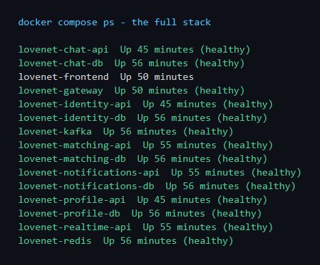
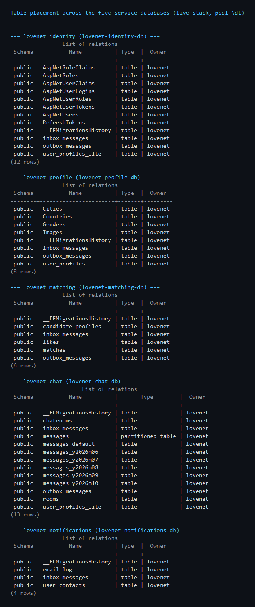
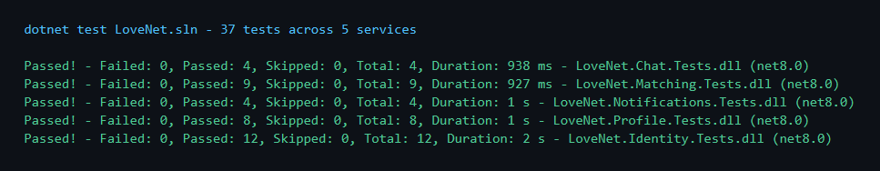

<h1 align="center">LOVE.NET</h1>
<p align="center"> ReactJS SPA dating application — now running on event-driven .NET 8 microservices
    <br>
</p>

## 📝 Table of Contents
- [About](#about)
- [Architecture](#architecture)
- [Getting Started](#getting_started)
- [Database Placement](#database_placement)
- [Tests](#tests)
- [Built Using](#built_using)

## 🧐 About <a name = "about"></a>
`LOVE.NET` gives you opportunity to match with people around the world and chat easily in real time.
Some accounts, countries, cities, genders are loaded after the first start of the application — through the same Kafka event pipeline production traffic uses.

This repository was refactored from a layered monolith into seven services built to scale the realtime chat workload horizontally. The original monolith is preserved on the [`monolith-snapshot`](../../tree/monolith-snapshot) branch.

## 🏗️ Architecture <a name = "architecture"></a>

```
React SPA ──► Gateway (YARP) ──► Identity │ Profile │ Matching │ Chat │ Realtime (SignalR) │ Notifications
                                     │         │         │        │        │                    │
                                  Postgres  Postgres  Postgres Postgres  Redis               Postgres
                                     └─────────┴────── Kafka (outbox → topics → inbox) ────────┘
```

* Authorized SignalR hub with a **Redis backplane** and Redis presence — no in-process state
* **Durable-before-display** chat: Kafka ack (keyed by room for ordering) before any client renders the message
* **Transactional outbox + inbox dedupe** on every service boundary, dead-letter queue for poison messages
* **Database-per-service** with event-carried read models — no cross-service joins
* Gateway with rate limiting, websocket proxying, and a resilient admin-stats fan-out
* Structured logs + OpenTelemetry traces (optional Jaeger), correlation ids across HTTP and Kafka hops

The full design — topics, delivery semantics, resiliency patterns, scaling story — is in [docs/ARCHITECTURE.md](docs/ARCHITECTURE.md).

## 🏁 Getting Started <a name = "getting_started"></a>

### Run the project

```
cp .env.example .env
```
```
docker compose up -d --build
```
```
SPA: http://localhost:3000 · Gateway: http://localhost:8080 · Swagger: http://localhost:8081..8086/swagger
```
```
./scripts/smoke-test.ps1  (20-step end-to-end proof of the whole stack)
```



### Authentication and Authorization

```
JWT Bearer token is being used for authentication and authorization (issued by Identity, validated by every service and the SignalR hub)
```
```
User is filling his mandatory data and uploading images.
```
```
Resend email verification if no email is received
```
```
Verification - required step in order to use the app
```
```
Reset password if forgotten
```

### User profile

```
Fast and easy edit of your profile information
```

```
Add and remove photos
```

### Home Tab

```
All not swiped users
```

```
Easy filtration by age, gender, distance in km calculated Latitude and Longitude of both users.
```
```
Easy swipe for mobile users, and buttons for PC master race fans
```
```
Upon successful match - notification is received (pushed over the hub to both users)
```

### Matches Tab

```
All matches you have got
```

```
Easy chat with option to send images
```
```
Infinite scrolling
```
```
Search your beloved ones
```

### Dashboard Tab
```
Up-to-date statistics (aggregated by the gateway from every service)
```

```
Infinite scrolling of users, with possibility to ban them
```
```
Search for intruders of the site
```

## 📈 Database Placement <a name = "database_placement"></a>
Every service owns its schema; the shared tables you see (`outbox_messages`, `inbox_messages`) are the reliable-messaging pattern, and `messages` in the chat database is a **partitioned table** with monthly partitions.



## 🧪 Tests <a name = "tests"></a>
* 37 NUnit tests across the five services (ported and adapted from the monolith suite)
* Plus a 20-step end-to-end smoke test against the live compose stack (`scripts/smoke-test.ps1`)
* 

## ⛏️ Built Using <a name = "built_using"></a>
* ReactJS
* .NET 8 APIs (7 services)
* EF Core 8 with PostgreSQL (database-per-service)
* Apache Kafka (KRaft)
* Redis
* YARP API Gateway
* Swashbuckle Swagger
* JWT Bearer
* SignalR (+ Redis backplane)
* Serilog + OpenTelemetry
* Cloudinary
* SendGrid
* NUnit
* Moq
* Axios
* React Bootstrap
* MomentJS
* React Tinder Card
* Docker Compose
