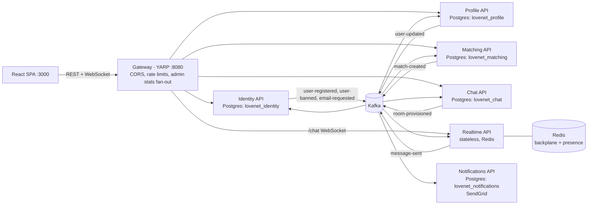

# LOVE.NET — Microservices Architecture

LOVE.NET is a dating app (swipe → match → chat) refactored from a layered
ASP.NET Core monolith into an event-driven microservices system designed to
scale a realtime chat workload to millions of users. The original monolith is
preserved on the `monolith-snapshot` branch.

## Why the monolith had to change

The monolith (single `ApplicationDbContext`, one SQL Server, one web process)
had five structural blockers, all verified in code before this refactor:

1. **Unauthenticated realtime.** The SignalR hub had no `[Authorize]`; the
   sender's identity was whatever the client claimed in the payload.
2. **Process-local state.** Room presence lived in an in-memory singleton
   dictionary (the code itself said `// Use Redis Cache for this`), and SignalR
   ran without a backplane — a second instance would split rooms in half.
3. **Display-before-durability.** The hub broadcast a message to clients
   *before* persisting it; a DB failure lost a message everyone already saw.
4. **Derived matches.** A "match" was recomputed from mutual likes on every
   request, and chat authorization string-parsed the room-id convention.
5. **One database for everything.** `ApplicationUser` was a mega-aggregate
   eagerly loading likes, images, geo data, roles, and tokens; every feature
   was coupled to every table.

## Target architecture



| Service | Port | Owns | Publishes | Consumes |
|---|---|---|---|---|
| Gateway (YARP) | 8080 | routing, CORS, rate limits, `/api/admin/dashboard` aggregation | — | — |
| Identity | 8081 | credentials (ASP.NET Identity), refresh tokens, JWT issuance, moderation | `identity.user-registered`, `identity.user-banned`, `notifications.email-requested` | `profile.user-updated` (login read model) |
| Profile | 8082 | profiles, images, countries/cities/genders | `profile.user-updated` (enriched) | `identity.user-registered`, `identity.user-banned` |
| Matching | 8083 | likes, **persisted matches**, candidate read model | `matching.match-created` | `profile.user-updated` |
| Chat | 8084 | messages (partitioned), chatrooms, provisioned rooms, history API | `chat.room-provisioned` | `chat.message-sent`, `matching.match-created`, `profile.user-updated` |
| Realtime | 8085 | SignalR hub, presence (Redis), match push | `chat.message-sent` | `matching.match-created`, `chat.room-provisioned` |
| Notifications | 8086 | email delivery, templates, contact read model | — | `notifications.email-requested`, `matching.match-created`, user events |

## Key flows

**Chat message (durable-before-display).**
Client → hub `SendMessage` → hub validates room membership and stamps
id/sender from JWT claims → **awaits Kafka produce** (`chat.message-sent`,
acks=all, key=roomId) → broadcasts `ReceiveMessage` via the Redis backplane →
Chat service consumer persists idempotently by message id. A message a client
has seen is always already in the broker; per-room ordering comes from the
partition key.

**Match.**
Matching inserts the like; on reciprocity it inserts the `matches` row **and**
the `matching.match-created` outbox event in one transaction. Downstream:
Chat provisions the room, Notifications emails both users, Realtime pushes
`MatchReceived` to both. The room id keeps the legacy convention (both user
GUIDs sorted, concatenated) so Chat/Realtime can authorize deterministically
even before the room event lands.

**Registration.**
Identity creates the account and writes `identity.user-registered` +
`notifications.email-requested` to its outbox in the same transaction. Profile
builds the profile aggregate and republishes the **enriched**
`profile.user-updated` (geo names, coordinates, avatar, images, ban/admin
flags) that every other service uses for its local read model. Demo users are
seeded through this same pipeline.

## Patterns applied (and the vocabulary they map to)

- **Transactional outbox / inbox.** State change + event commit atomically;
  each consumer registers the envelope `MessageId` in the same transaction as
  its side effects. Delivery is **at-least-once**; idempotent handlers make
  processing **effectively-once**.
- **Ordering guarantees.** Only per partition: `chat.message-sent` and
  `matching.match-created` are keyed by roomId, user events by userId. No
  global ordering is promised, and nothing depends on one.
- **CAP / consistency spectrum.** Within a service: strong consistency
  (Postgres). Between services: **eventual consistency** through Kafka. The
  visible windows (match toast before room row; profile edits reaching the
  deck) are bounded by consumer lag and mitigated by the deterministic room-id
  fallback authorization.
- **Stateless vs stateful tiers.** Every API tier is stateless; state lives in
  Postgres/Redis/Kafka. Realtime keeps no in-process state at all — presence
  is in Redis, group fan-out goes through the backplane — so it scales
  horizontally (with sticky negotiate or `skipNegotiation` + WebSockets).
- **Resiliency patterns.** Timeouts, retry-with-backoff and circuit breakers
  on the gateway's HTTP fan-out (`Microsoft.Extensions.Http.Resilience`);
  graceful degradation (fallback) in the stats aggregation; **rate limiting**
  at the gateway (fixed window per IP, tighter on credentials, token bucket on
  likes); **bulkhead** isolation via database-per-service and per-service
  containers; **dead-letter queue** after bounded consumer retries so a poison
  message never stalls a partition.
- **Observability.** Serilog structured logs (JSON outside Development),
  OpenTelemetry traces + metrics with OTLP export (optional Jaeger container
  behind the `observability` compose profile), correlation ids propagated
  HTTP → outbox envelope → consumers, `/health` per service covering its real
  dependencies.

## The chat data model

Messages are write-heavy and read-recent ("last N per room"). The `messages`
table is **range-partitioned by month** on `created_on` (hand-written SQL in
the initial migration; a DEFAULT partition catches strays and startup code
pre-creates months around now), with the read index `(room_id, created_on
DESC)`. All access goes through the narrow `IMessageStore` seam
(append + page-by-room), which is exactly the shape a Cassandra/ScyllaDB
implementation keyed on `(room_id, time_bucket)` needs — that swap is the
documented scale-out path Discord took, and it requires no caller changes.

## Scaling story (HA)

- **Realtime**: N replicas behind the gateway; Redis backplane fans broadcasts
  across instances; presence is shared state in Redis. WebSockets need session
  affinity for the negotiate handshake (or `skipNegotiation`).
- **Kafka**: `chat.message-sent` has 8 partitions — up to 8 parallel Chat
  consumers; scale by partitions.
- **APIs**: stateless; scale horizontally behind the gateway/LB.
- **Postgres**: read replicas per service; Chat's growth path is the
  `IMessageStore` swap above. Reference data (countries/genders) can be
  cached in Redis.
- **Outbox publisher**: single instance per service by design; scaling it out
  needs row locking (`FOR UPDATE SKIP LOCKED`) — documented, not built.

## Security notes / production hardening

- All services validate the same **HS512** JWT (shared key via env). This kept
  token issuance byte-compatible with the monolith, but one leaked key forges
  tokens everywhere. The production upgrade is asymmetric signing: Identity
  signs **RS256** and exposes JWKS; validators fetch the public key — a
  config-level change in `BuildingBlocks.Web`.
- The hub authenticates via `access_token` query parameter (SignalR standard);
  the gateway terminates TLS in production.
- Secrets flow through `.env` (gitignored; `.env.example` documents the keys).
  Cloudinary/SendGrid degrade gracefully when unconfigured for local dev.

## What was deliberately NOT built

- **Sagas/compensation** — the only multi-service write flow (registration)
  is safe with outbox + retries; no rollback semantics are needed yet.
- **DLQ replay tooling** — dead-lettered messages carry origin headers but
  replay is manual (`kafka-console-consumer`/`producer`).
- **Kubernetes manifests** — compose is the deployment story here; the
  services are 12-factor and container-ready.
- **Schema registry / Avro** — JSON envelopes with a `version` field; a
  registry earns its keep only with many producers per topic.
- **Read-receipts / typing indicators** — parity with the monolith was the
  goal; the hub is the obvious place to add them.

## Running locally

```bash
cp .env.example .env        # fill Cloudinary/SendGrid if you want images/emails
docker compose up -d --build
./scripts/smoke-test.ps1    # end-to-end proof
# SPA: http://localhost:3000, gateway: http://localhost:8080
# optional tracing UI: docker compose --profile observability up -d jaeger
```
